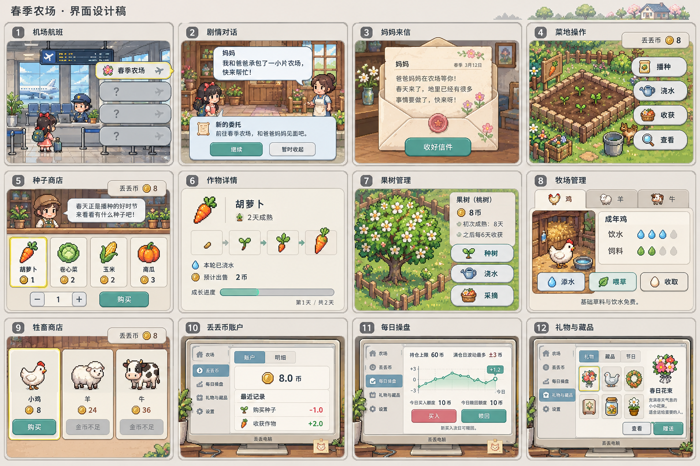

# 春季玩法 UI 视觉设计稿

用户要求绘制的整套视觉提案，2026-11-02 补交到仓库。原先只在聊天中生成，Cloud 无法读取；现在图片直接由 Git 跟踪。

涵盖机场航班、剧情对话、妈妈来信、菜地操作、种子商店、作物详情、果树管理、牧场管理、牲畜商店、丢丢币账户、每日操盘、礼物与藏品。

**状态：生成式视觉概念稿，不是已切分的游戏素材，也不是已实现的界面。** 不可据此宣称农场/币制 UI 已完成。实现继续遵循 pixel-art 规范及最新系统文档。

落地时需修正图中与需求不符之处：
- 航班与地块操作要环形气泡，不能照抄图中的竖排列表。
- 剧情说话使用人物气泡，不能重新引入底部整块白框作为对白。
- 场景、角色沿用现有原生像素比例；本稿的透视、细节密度与平滑边框只是视觉参考，不直接替换原美术。
- 生成图中文字可能有错字；货币统一写“丢丢币”，所有文案需重新排版。
- 价格/额度以 `../DIDI_CURRENCY.md` 为准；最新已确认航班0币、农场解锁后全年开放，见最新系统文档。

接手先读 `../NEXT_AGENT_HANDOFF.md`。用户这次要求补交设计图，不代表授权追加整套玩法实现。
